# Computer vision on a 58-image dataset: classification and detection

**Data:** `~/Downloads/IMG_0435 … IMG_0492` (58 iPhone photos, 3024×3024 HEIC). Each photo existed as both `.heic` and `.HEIF`; the two decode to the same pixels (mean abs. difference 0.002/255), so the `.heic` copies were used.
**Hardware:** Apple M5 Pro (16-core GPU via PyTorch MPS), 24 GB unified memory
**Date:** 2026-11-10

---

## TL;DR

1. **The dataset is small and its domains are imbalanced.** There are 4 objects (penguin figurine, hippo toy, AA battery, game controller). 41 studio shots on a plain grey background, 13 single-object shots on a cluttered desk, and 4 multi-object scenes. Most objects on the desk are about 2.6× smaller than in the studio shots.
2. **Random cross-validation is misleading here.** Almost every classifier scores 96–100% in mixed-domain 5-fold CV. When trained only on studio images and tested on the desk images, the same classifiers fall to between 23% and 85%. In-domain accuracy does not predict robustness.
3. **The failures come from finding the object, not recognising it.** Give the same frozen-feature classifiers a crop around the object and *every* backbone reaches **13/13 (100%)** on the desk images. Grad-CAM shows that a fine-tuned ResNet-18 latched onto a **shortcut**. It calls every desk photo "controller" because it attends to a **mint-green USB dongle** on the desk, which has the same colour as the controller.
4. **Pretrained frozen features beat fine-tuning at this scale.** CLIP, DINOv2, SigLIP2 and EfficientNet features with kNN, nearest-prototype or logistic regression match or beat full fine-tuning, and stay ahead under domain shift. Models trained from scratch fit the studio images (86–94% CV) but are at chance on the desk (18–23%).
5. **For detection, copy-paste augmentation was the most effective change.** YOLO11n trained on the 41 studio images reaches mAP@0.5 = **0.58 ± 0.11** over 3 seeds, and is unstable. Adding 300 synthetic images pasted from the *same* 41 images (SAM masks, random scale) gives **0.85 ± 0.01**. It also lifts F1 at a 0.5 confidence threshold from **0.46 → 0.83**.
6. **mAP and deployment quality disagree.** Faster R-CNN has the best studio→desk mAP@0.5 (0.91), but at a 0.5 threshold its precision is only 0.43: it hallucinates objects in the desk clutter. YOLO11n with copy-paste is the best deployable model: F1 0.83 at about 10 ms per image, against 107 ms for Faster R-CNN.
7. **A few in-domain labels beat clever augmentation.** Adding just 8 desk images (2 per class) takes YOLO11n to mAP@0.5 = 0.95 and Faster R-CNN to 1.00. Copy-paste on top of that gives the best F1 (0.95).
8. **Annotation was cheap and independently verified.** Boxes came from OWLv2 proposals, a saturation-mask rule and 5 manual fixes, and I visually reviewed all 70. Cloudflare Workers AI **clef** (27B) agreed with all 58/58 image labels. Total API spend: **≈ $0.04**.

---

## 1. Data and annotation

### 1.1 What the photos contain

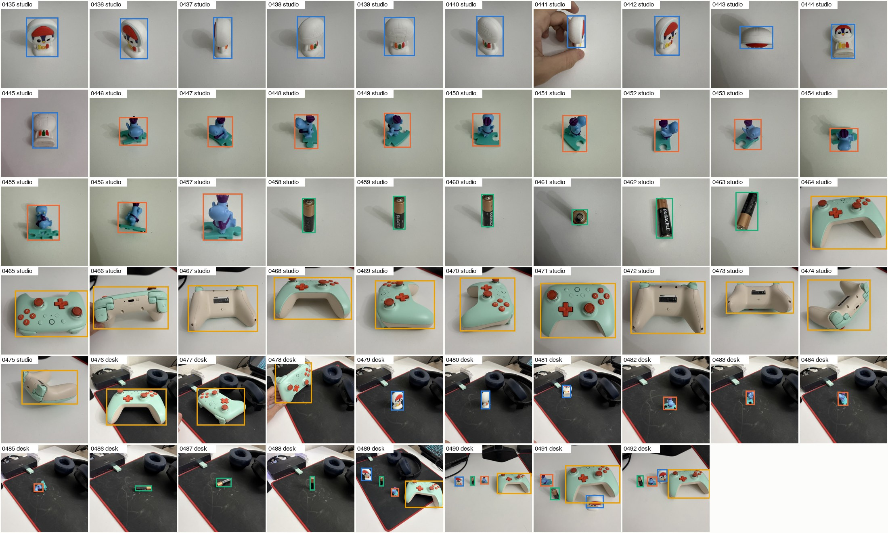

*All 58 images with the final bounding boxes. Colours: penguin = blue, hippo = orange, battery = green, controller = yellow.*

| | penguin | hippo | battery | controller | multi-object |
|---|---|---|---|---|---|
| studio (plain grey background) | 11 | 12 | 6 | 12 | – |
| desk (black mouse-pad, headphones, USB hub, cables) | 3 | 4 | 3 | 3 | 4 (16 boxes) |

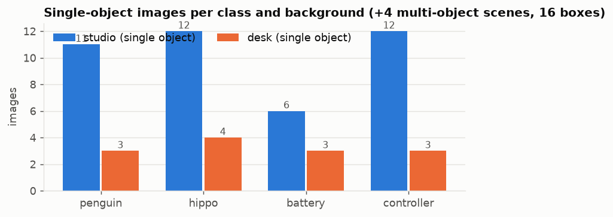
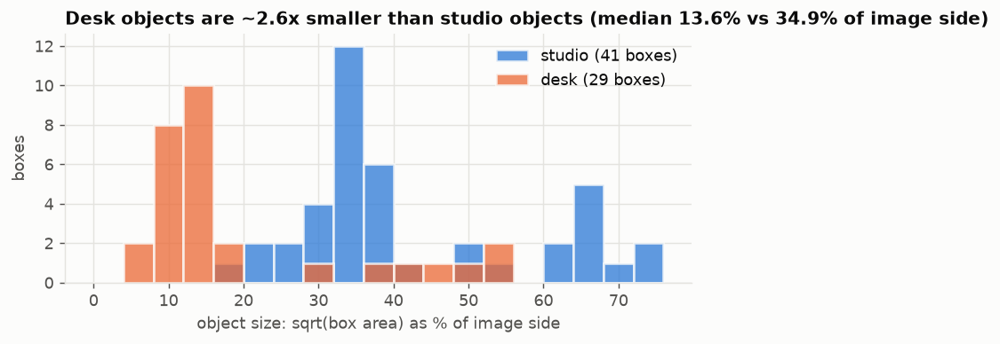

Things about this data that matter for modelling:

* **Two domains.** The studio shots are close-ups on a near-uniform background. The desk shots are wide and cluttered, with distractors such as headphones, a USB hub and a mint-green USB stick.
* **Scale gap.** Measured as √(box area) / image side, the median object is 34.9% in the studio and 13.6% on the desk (smallest 7.5%).
* **Pose variety.** The penguin appears from the back (an almost featureless white dome), the side, upside down (0443) and partly occluded by fingers (0441). The battery appears upright, lying down and end-on (0461).
* **Class imbalance.** There are 6 battery studio images against 11–12 for the other classes.
* **Spurious correlations.** Some studio controller shots (0466–0475) show desk edges and dark clutter in the corners. The mint-green controller shares its colour with the USB stick on the desk. Section 3.4 shows that a CNN exploits exactly this.

### 1.2 How the labels were produced

There were no labels, so I created two kinds:

* **Image-level class** (54 single-object images) and **domain**, by inspecting every image.
* **Bounding boxes** (70 boxes; the hippo box *includes* its puzzle-piece base):

| source | boxes | notes |
|---|---|---|
| OWLv2 (`owlv2-base-patch16-ensemble`) proposal, class-specific prompt | 36 | top box per known class |
| OWLv2 with an alternative prompt ("white toy figurine") | 10 | the penguin prompt failed on back views |
| OWLv2 hippo box ∪ "teal puzzle piece" box | 7 | desk hippos, to include the base |
| HSV-saturation blob (studio hippo) | 12 | the toy and base are saturated; the background is grey |
| manual coordinates | 5 | 0443, 0445, 0481, 0491, 0492 (penguin) |

I reviewed every box on overlay contact sheets and fixed failures. The rules and overrides are in `src/compose_annotations.py` and `data/manual_boxes.json`, and the final labels in `data/annotations.json` (plus YOLO format under `data/yolo/`). For the copy-paste experiments, SAM (`sam-vit-base`) produced box-prompted masks for every object:

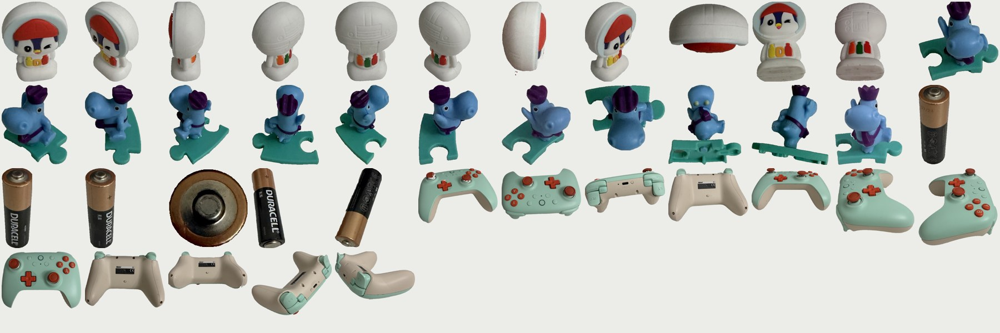

### 1.3 Independent check with Cloudflare Workers AI (clef decision models)

Each image went to the three clef models with 6 typed questions: the main object (choice), presence of each class (yes/no × 4), and the scene. The responses are in `results/clef_annotations.json`.

| model | main-object label agrees | presence (232 yes/no) agrees | scene agrees | input tokens | cost |
|---|---|---|---|---|---|
| `@cf/cloudflare/clef` (27B) | **58/58** | 230/232 | 56/58 | 89.6k | $0.0215 |
| `@cf/cloudflare/clef-flash` (9B) | 56/58 | 229/232 | 56/58 | 89.6k | $0.0034 |
| `@cf/cloudflare/clef-omni` (30B MoE) | 53/58 | 229/232 | 54/58 | 89.1k | $0.0134 |

**Total spend ≈ $0.039.** The disagreements are borderline cases: clef-omni labels three of the four multi-object scenes "controller" because the controller dominates the frame, and clef-flash calls the lying battery 0486 "multiple". Agreement with the largest model is perfect, so I treat my labels as reliable. The image-level labels are effectively unambiguous here. The real annotation risk is box *tightness*, and the next caveat follows from it.

> **Caveat.** OWLv2 proposals seeded about 75% of the boxes, so OWLv2's own zero-shot detection score (Section 4) is **optimistically biased**. Grounding DINO is the unbiased zero-shot reference.

---

## 2. Experimental design

### Tasks and splits

| task | protocol | train | test |
|---|---|---|---|
| A. 4-class image classification | **CV**: stratified 5-fold (10 repeats for frozen features, 2 for fine-tuning) | 4/5 of the 54 | 1/5 |
| | **Shift**: studio → desk | 41 studio | 13 desk |
| | **Few-shot**: k ∈ {1, 2, 3, 5} studio images per class, 30 random draws | 4k | 13 desk (fixed) *and* the unused studio images (balanced accuracy) |
| | **Shift-crop**: like Shift, on crops around the ground-truth box (20% padding) | 41 studio crops | 13 desk crops |
| B. 4-class object detection | **S1**: studio → desk | 41 studio | 13 desk single + 4 multi-object (29 boxes) |
| | **S2**: mixed | 41 studio + 8 desk (2/class) | 5 desk single + 4 multi-object (21 boxes) |
| | **Learning curve**: S1 with 1, 2, 4 or all studio images per class | 4 / 8 / 16 / 41 | as S1 |

No test image is ever used for model selection. Detectors are evaluated from their **last** epoch: Ultralytics' per-epoch validation was disabled, and the YAML `val` points at the train images. All detection metrics come from one shared evaluator (`src/det_eval.py`: torchmetrics/pycocotools COCO mAP on 1024 px coordinates), so YOLO, Faster R-CNN and zero-shot models are scored identically.

### Models

| family | models |
|---|---|
| classical | HSV colour histogram (12×4×4) → RBF-SVM / 1-NN |
| frozen pretrained features (+ logistic regression, 1-NN cosine, nearest class prototype; h-flip as augmentation) | ResNet-50 (IN-1k), EfficientNet-B0 (IN-1k), ConvNeXt-T (IN-22k), DINOv2 ViT-S/14 and ViT-B/14 (CLS + mean patch), CLIP ViT-B/16, SigLIP2 B/16 |
| end-to-end fine-tuning (AdamW, one-cycle LR, label smoothing, RandomResizedCrop(0.15–1), rotation, colour jitter, 40 epochs) | ResNet-18, EfficientNet-B0, ConvNeXt-T |
| trained from scratch (120 epochs) | 4-block small CNN (≈1.2 M params), ResNet-18 |
| zero-shot classification | CLIP ViT-B/16, SigLIP2 (text prompts); clef / clef-flash / clef-omni (Workers AI) |
| detectors, fine-tuned from COCO | YOLO11n, YOLO11s, YOLOv8n (Ultralytics, 640 px, 80 epochs; also YOLO11n at 960 px), Faster R-CNN ResNet50-FPN v2 (torchvision, 30 epochs) |
| detectors from scratch | YOLO11n (200 epochs) |
| detection augmentation | copy-paste: 300 synthetic images from SAM-masked *train* objects pasted onto *train* backgrounds (random scale 4–45% of the image side, flip, ±25° rotation, brightness jitter, 50% random zoom on the background); see below |
| zero-shot detection | OWLv2-B/16 (biased, see above), Grounding DINO-Tiny |

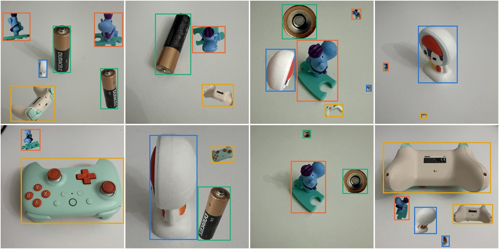

*Copy-paste synthetic training images for S1. Only studio objects and backgrounds are used, so nothing from the desk domain leaks in.*

---

## 3. Results: classification

### 3.1 CV vs. domain shift vs. object crops

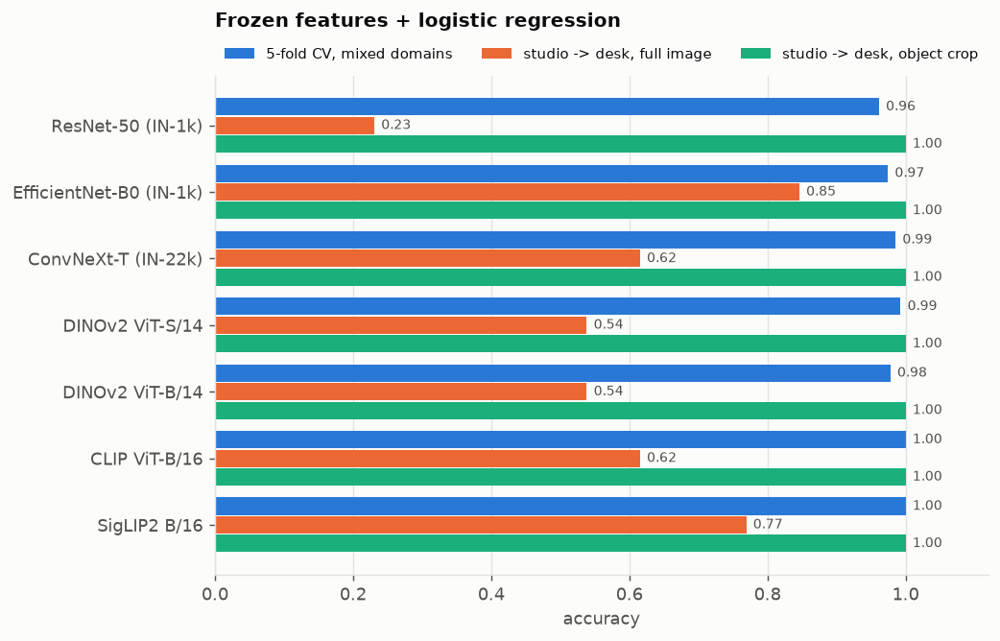

| frozen backbone + logistic regression | 5-fold CV | studio→desk (95% bootstrap CI) | studio→desk, object crop |
|---|---|---|---|
| ResNet-50 (IN-1k) | 0.961 ± 0.055 | 0.23 [0.00, 0.46] | **1.00** |
| EfficientNet-B0 (IN-1k) | 0.974 ± 0.041 | **0.85** [0.62, 1.00] | **1.00** |
| ConvNeXt-T (IN-22k) | 0.985 ± 0.042 | 0.62 [0.38, 0.85] | **1.00** |
| DINOv2 ViT-S/14 | 0.993 ± 0.031 | 0.54 [0.31, 0.77] | **1.00** |
| DINOv2 ViT-B/14 | 0.978 ± 0.047 | 0.54 [0.31, 0.77] | **1.00** |
| CLIP ViT-B/16 | **1.000 ± 0.000** | 0.62 [0.31, 0.85] | **1.00** |
| SigLIP2 B/16 | **1.000 ± 0.000** | 0.77 [0.54, 1.00] | **1.00** |
| *colour histogram + SVM* | 0.842 ± 0.077 | 0.23 [0.00, 0.46] | – |

The three classifier heads give different shift results on the same features: kNN and nearest-prototype are often more robust than logistic regression (for example, CLIP is 0.62 with logistic regression and 0.85 with kNN or prototype; DINOv2-S is 0.54 → 0.85). With only 13 test images, the confidence intervals are about ±25 points, so differences of one or two images are noise. The **crop result is not noise**: 7/7 backbones × 3 heads all reach 13/13.

**Interpretation.** The pretrained representations already separate these four objects perfectly once the object fills the frame. Full-image classification fails on the desk because (a) the object covers only about 2% of the pixels, so the global embedding is dominated by background, and (b) the training set has no examples of "small object in clutter". **The right fix is localisation (detection, or detect-then-classify), not a better classifier.**

### 3.2 All classifiers: in-domain vs. shift

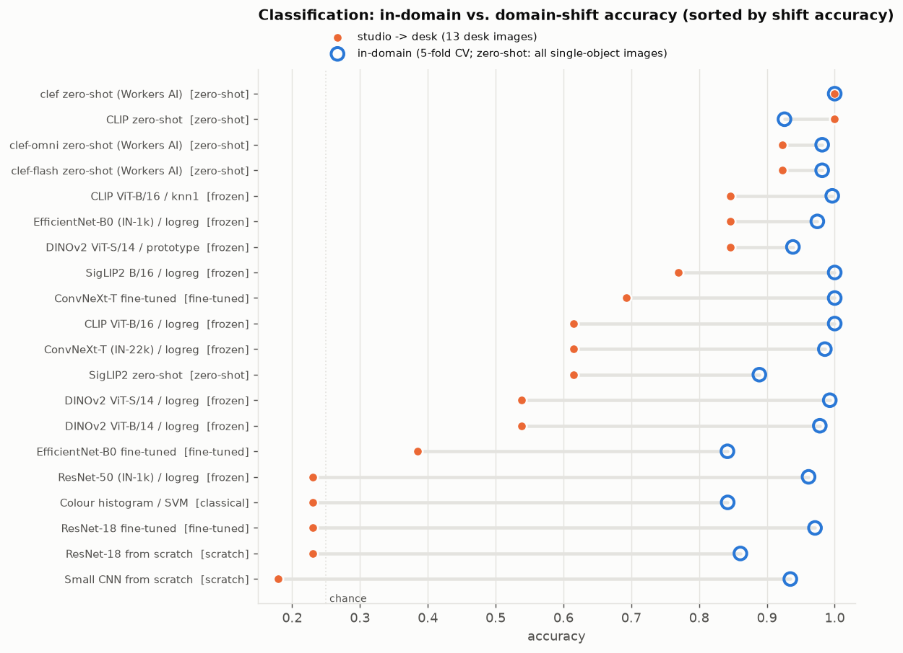

| method | CV | studio→desk |
|---|---|---|
| clef (27B) zero-shot | 1.00* | **1.00** |
| CLIP ViT-B/16 zero-shot | 0.93* | **1.00** |
| clef-flash / clef-omni zero-shot | 0.98* | 0.92 |
| CLIP kNN / DINOv2-S prototype / EfficientNet-B0 logistic regression (frozen) | 0.94–1.00 | 0.85 |
| ConvNeXt-T **fine-tuned** | **1.000 ± 0.000** | 0.69 (seeds: 0.77 / 0.46 / 0.85) |
| EfficientNet-B0 fine-tuned | 0.842 ± 0.095 | 0.38 |
| ResNet-18 fine-tuned | 0.971 ± 0.044 | **0.23** (always "controller") |
| ResNet-18 from scratch | 0.861 ± 0.074 | 0.23 |
| small CNN from scratch | 0.935 ± 0.072 | 0.18 |

\*For zero-shot methods the "CV" column is accuracy on all 54 single-object images, since there is no training.

* **Zero-shot vision-language models are the most robust**, because they were never fitted to the studio background. CLIP zero-shot is better on the desk (13/13) than on the studio images (37/41: the back-view penguins are hard). SigLIP2 zero-shot gets only 0.62 on the desk, so prompt sensitivity is high.
* **Fine-tuning a full network on 41 images overfits the domain.** It reaches CV equal to or better than frozen features, but is much worse under shift and has high seed variance: ConvNeXt-T moves between 0.46 and 0.85 depending only on the seed.
* **From-scratch models** fit the studio distribution reasonably (86–94% CV) but learn nothing transferable.

### 3.3 Few-shot

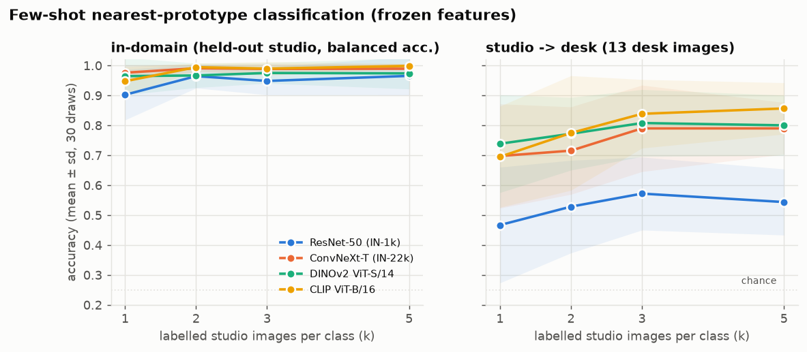

With frozen features and a nearest-class-mean classifier, **one labelled image per class already gives 90–98% balanced accuracy in-domain**. Under shift, accuracy climbs slowly with k (CLIP: 0.70 → 0.86 from k = 1 to 5; ResNet-50: 0.47 → 0.54). Supervised ImageNet ResNet-50 features are clearly the worst foundation for few-shot transfer. CLIP, DINOv2 and ConvNeXt-22k are close to each other.

### 3.4 Why the fine-tuned CNN fails: shortcut learning

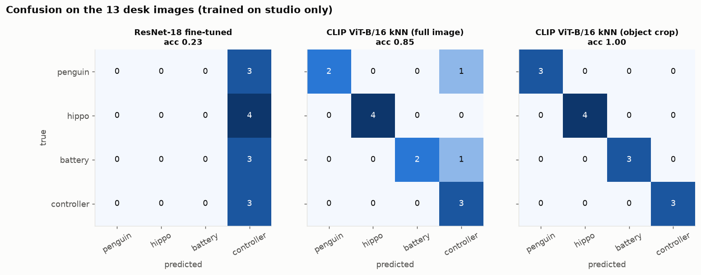
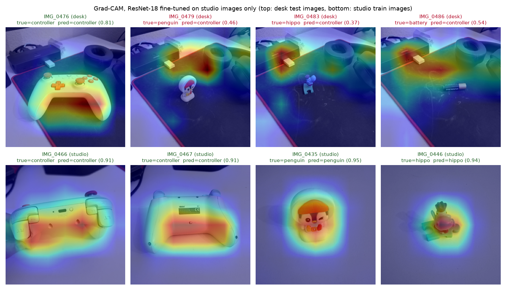

The fine-tuned ResNet-18 classifies **every** desk image as *controller*. Grad-CAM shows that on the desk it does not look at the penguin, hippo or battery at all. It attends to the **mint-green USB stick** and to the clutter around the USB hub. In the training set, mint green and dark clutter co-occur *only* with the controller: it is the only mint-green object, and the only class shot near the desk edge. On studio images the attention sits correctly on the object. This is the classic small-data failure: the network learns the cheapest feature that separates the training set. Frozen generic features plus a simple head cannot "re-learn" low-level cues this way, which is why they are more robust.

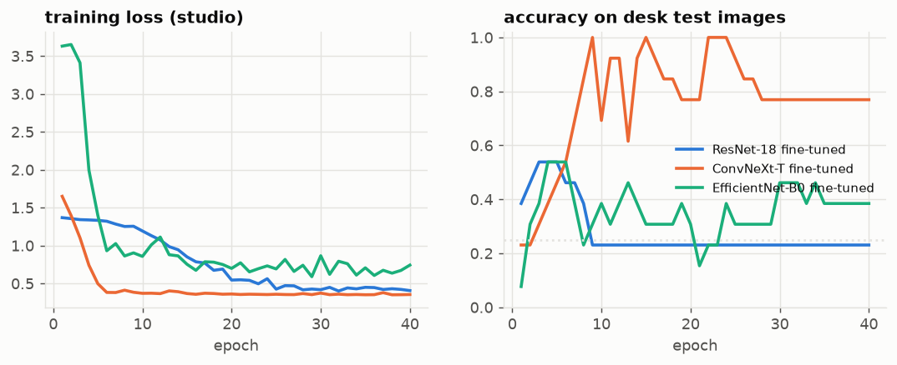

*Desk accuracy during fine-tuning (monitoring only; never used for selection). ResNet-18 locks into the shortcut after about 8 epochs. ConvNeXt-T swings between 0.6 and 1.0 from epoch to epoch, so any reported number depends on where training stopped.*

---

## 4. Results: object detection

### 4.1 Headline numbers

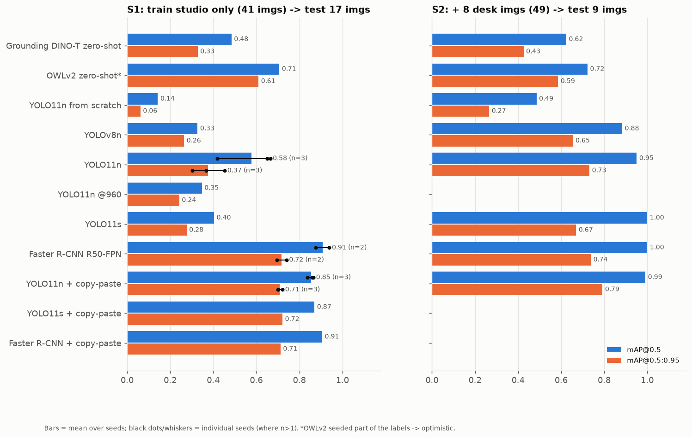

**S1: train on studio only (41 images), test on 13 desk + 4 multi-object images (29 boxes)**

| model | seeds | mAP@0.5 | mAP@0.5:0.95 | P @0.5 | R @0.5 | F1 @0.5 | latency (MPS / CPU) |
|---|---|---|---|---|---|---|---|
| Grounding DINO-T, zero-shot | – | 0.48 | 0.33 | 0.61 | 0.48 | 0.54 | – |
| OWLv2, zero-shot *(biased)* | – | 0.71 | 0.61 | 0.93 | 0.48 | 0.64 | – |
| YOLO11n **from scratch** | 1 | 0.14 | 0.06 | 0.60 | 0.10 | 0.18 | 10 / 24 ms |
| YOLOv8n | 1 | 0.33 | 0.26 | 0.70 | 0.24 | 0.36 | 8 / 23 ms |
| YOLO11n | 3 | 0.58 ± 0.11 | 0.37 ± 0.06 | 0.88 | 0.31 | 0.46 | 10 / 24 ms |
| YOLO11n @ 960 px | 1 | 0.35 | 0.24 | 0.83 | 0.17 | 0.29 | – |
| YOLO11s | 1 | 0.40 | 0.28 | 0.75 | 0.21 | 0.32 | 13 / 44 ms |
| Faster R-CNN R50-FPN v2 | 2 | **0.91** | **0.72** | 0.43 | **0.91** | 0.59 | 107 / 448 ms |
| **YOLO11n + copy-paste** | 3 | 0.85 ± 0.01 | 0.71 ± 0.01 | 0.81 | 0.85 | **0.83** | **10 / 24 ms** |
| YOLO11s + copy-paste | 1 | 0.87 | 0.72 | **0.96** | 0.83 | **0.89** | 13 / 44 ms |
| Faster R-CNN + copy-paste (10 epochs) | 1 | 0.91 | 0.71 | 0.28 | 0.93 | 0.43 | 107 / 448 ms |

**S2: add 8 desk images (2 per class) to training; test on 5 desk + 4 multi-object images (21 boxes)**

| model | mAP@0.5 | mAP@0.5:0.95 | F1 @0.5 |
|---|---|---|---|
| Grounding DINO-T / OWLv2, zero-shot | 0.62 / 0.72 | 0.43 / 0.59 | 0.65 / 0.65 |
| YOLO11n from scratch | 0.49 | 0.27 | 0.45 |
| YOLOv8n | 0.88 | 0.66 | 0.69 |
| YOLO11n | 0.95 | 0.73 | 0.78 |
| YOLO11s | **1.00** | 0.67 | 0.92 |
| Faster R-CNN | **1.00** | 0.74 | **1.00** |
| **YOLO11n + copy-paste** | 0.99 | **0.79** | 0.95 |

"± x" is the standard deviation over seeds. P/R/F1 use a 0.5 confidence threshold, IoU ≥ 0.5 and class-aware greedy matching (`src/operating_point.py`). Latency is per 640 px image, measured on an idle GPU after training. Training wall-clock is in `results/det_summary_rows.json`, but most jobs shared the GPU, so those times are only roughly comparable (YOLO11n 3–9 min and Faster R-CNN 5–11 min without copy-paste; copy-paste runs up to ~75 min).

### 4.2 What the numbers say

**(a) Pretraining is non-negotiable.** The same YOLO11n architecture trained from scratch reaches mAP@0.5 of 0.14 (S1) and 0.49 (S2). COCO pretraining is worth 0.4–0.5 mAP at this data size.

**(b) Studio-only YOLO training is a lottery.** Three seeds of an identical YOLO11n run give 0.67, 0.65 and 0.42 mAP@0.5. The spread between YOLO variants (v8n 0.33, 11n 0.58, 11s 0.40, 11n@960 0.35) is about as large as the seed spread, so **no architecture ranking on S1 without copy-paste is meaningful**. In every case the failure mode is low recall on small desk objects. The detectors are precise (0.7–1.0) but find only 10–34% of the objects, because nothing in the studio set looks like a 10%-of-frame object in clutter.

**(c) Copy-paste closes most of the gap, and removes the variance.** Pasting the same 41 objects at random scales onto the same backgrounds multiplies the number of (object, scale, position, context) combinations. YOLO11n goes from 0.58 ± 0.11 to **0.85 ± 0.01** mAP@0.5, and recall from 0.31 to 0.85. YOLO11s is helped even more (0.40 → 0.87). No desk images or extra labels were used.

**(d) The two-stage detector generalises better under shift, but it is not deployable as is.** Faster R-CNN reaches the best S1 mAP without any augmentation. Region proposals plus ROI classification handle small objects in new contexts better. However, it emits many confident false positives on the headphones, USB hub and mouse-pad (29–42 false positives at score ≥ 0.5, against 1–10 for YOLO + copy-paste). mAP does not penalise these because they rank below the true positives. Copy-paste *hurt* Faster R-CNN's precision (0.43 → 0.28), probably because pasted objects on studio backgrounds teach "anything on a background is an object". That run also had only 10 epochs.

**(e) Higher input resolution did not help** (YOLO11n at 960 px: 0.35). With so few training images, the larger input just changes the effective object scale and anchor statistics without adding examples.

**(f) Zero-shot detectors are a reasonable no-training baseline but plateau.** Grounding DINO is excellent on the clean multi-object scenes (0.88 mAP@0.5) and poor on the cluttered single-object shots (0.15), where it labels headphones as penguins and USB hubs as batteries. Fine-tuned detectors with copy-paste beat both zero-shot models on every split.

**(g) A handful of in-domain images is worth more than everything else.** Adding 8 desk images (S2) brings every pretrained detector to 0.88–1.00 mAP@0.5. The S2 test set (5 desk + 4 multi-object images) is a subset of S1's test images, so the comparison is indicative rather than exact. Still, if the deployment domain is known, **label a few images from it**.

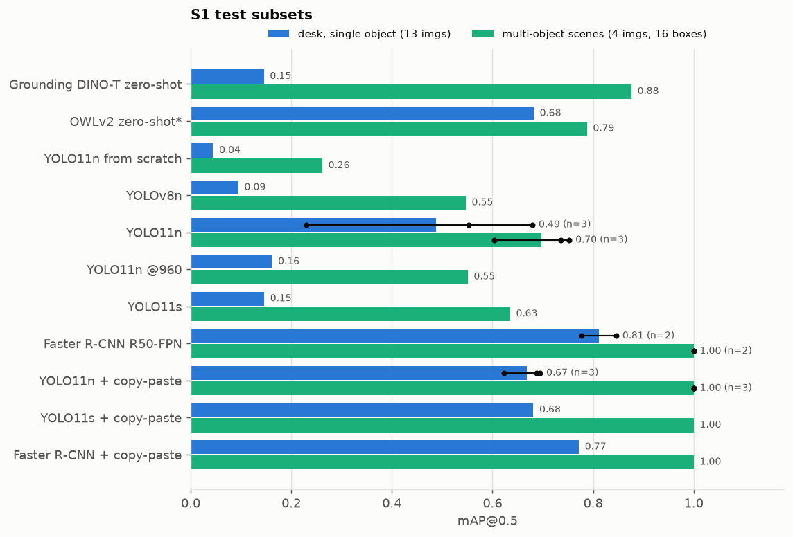
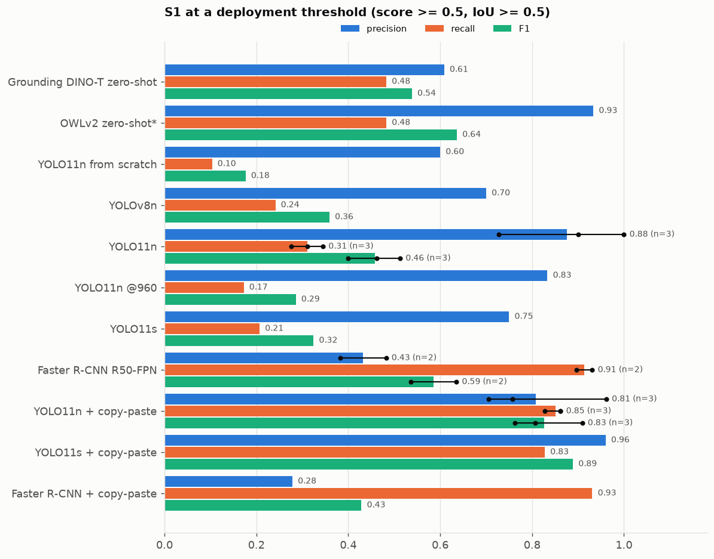
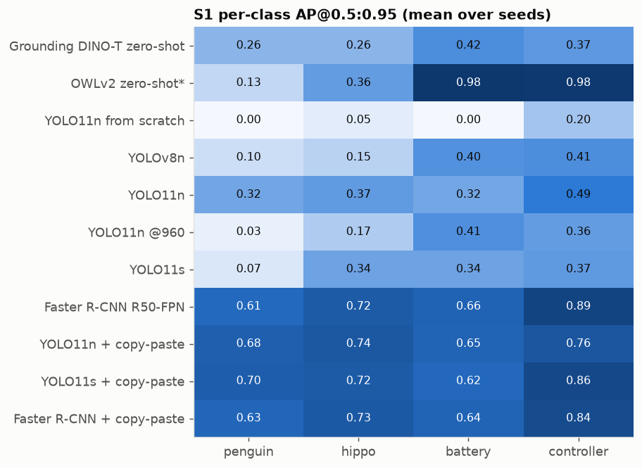

The multi-object scenes are *easier* than the single-object desk shots for all trained models. Three of the four multi-object scenes are on a white desk, with medium-sized objects and no headphones or USB-hub clutter. Battery and penguin are the hardest classes: the battery is thin and appears lying flat on the desk, a pose seen only twice in training, and the penguin's back view is a featureless white dome.

### 4.3 Learning curve

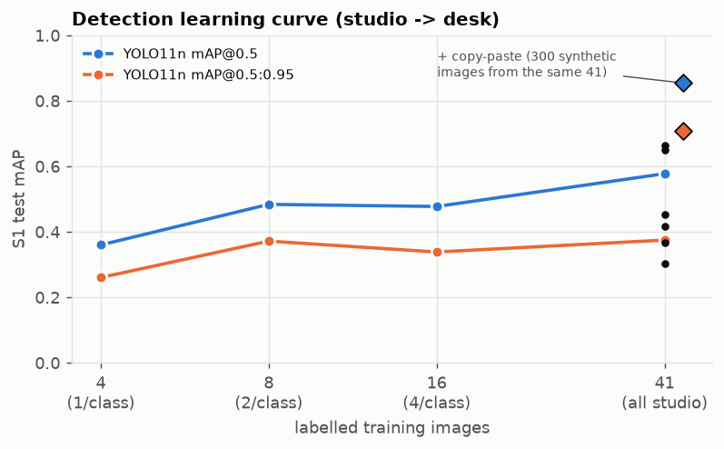

| studio images per class | 1 | 2 | 4 | ~10 (all 41) | all 41 + copy-paste |
|---|---|---|---|---|---|
| YOLO11n mAP@0.5 (S1) | 0.36 | 0.48 | 0.48 | 0.58 ± 0.11 | **0.85 ± 0.01** |

Adding more *studio* images gives diminishing returns for the *desk* test: going from 2 to 10 images per class adds about 0.1 mAP. Synthesising scale and context diversity from the images already in hand adds about 0.27.

### 4.4 Qualitative examples (S1, score ≥ 0.35)

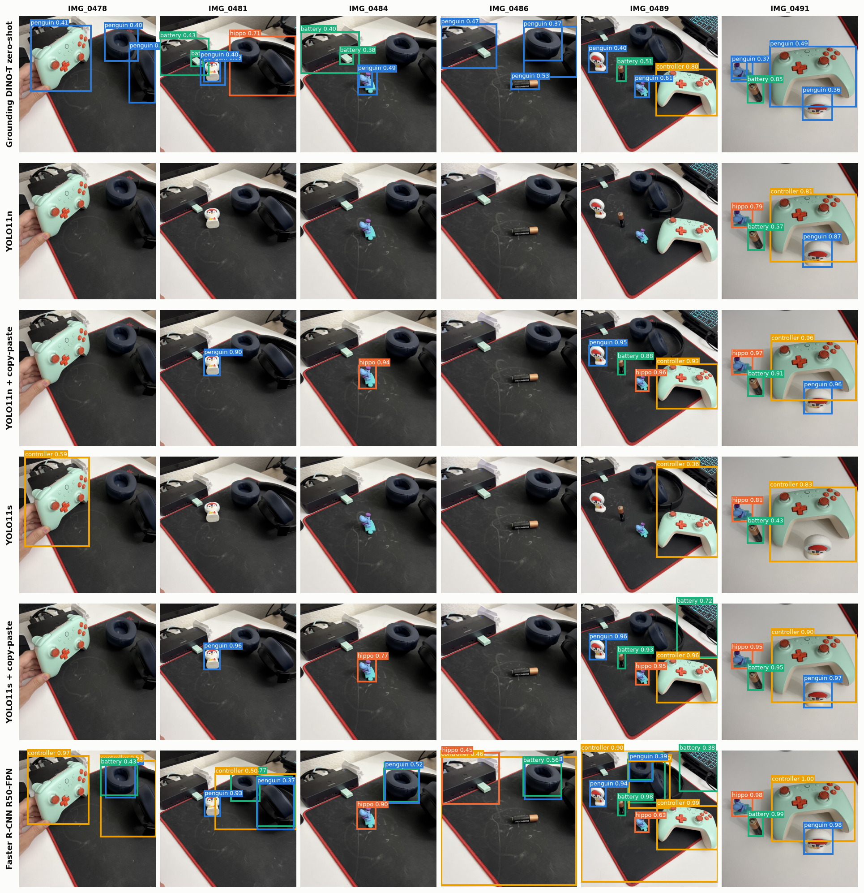

*Rows: Grounding DINO zero-shot (mislabels headphones and the USB hub), YOLO11n (misses everything except the multi-object scene), YOLO11n + copy-paste (clean; misses the hand-held controller and the flat battery), YOLO11s, YOLO11s + copy-paste, Faster R-CNN (finds everything, plus many hallucinated boxes on the headphones and hub).*

---

## 5. Linking the two tasks

Using the detector's top-scoring box as an image-level classifier on the 13 desk images:

| method (trained on studio only) | desk accuracy |
|---|---|
| ResNet-18 fine-tuned classifier | 0.23 |
| best frozen-feature classifier (full image) | 0.85 |
| YOLO11n (top detection) | 0.62 (mean of 3 seeds) |
| Faster R-CNN (top detection) | 0.73 (mean of 2 seeds) |
| **YOLO11n + copy-paste (top detection)** | **0.87** (34/39 over 3 seeds) |
| frozen classifier on an *oracle* crop | 1.00 |

A **detect → crop → frozen-feature-classify** pipeline is the logical next step. The crop experiment shows that the classification stage is already perfect, so overall accuracy would be bounded by the detector's localisation recall (0.85 for YOLO11n + copy-paste).

---

## 6. Recommendations

1. **Use the domain-shift split, not random CV, to pick models.** Mixed-domain CV saturated at 96–100% for almost every model and did not predict which models survive the domain shift.
2. **Use frozen foundation-model features (CLIP / DINOv2 / SigLIP2) with kNN or prototypes for classification.** They need no hyperparameters, train in milliseconds, work from one shot per class, and are robust. Fine-tune end-to-end only with far more data or with in-domain images.
3. **For detection, start from YOLO11n (COCO) + SAM-based copy-paste.** It is accurate (F1 0.83 studio→desk, 0.95 with 8 desk images), stable across seeds, and 10 ms per image. Use Faster R-CNN if recall matters more than precision, together with a score-threshold or hard-negative pass on background clutter.
4. **Spend the next annotation effort on the target domain.** Two desk photos per class moved detection mAP@0.5 from ~0.6 to ~0.95–1.0 (on the smaller S2 test set). Prioritise small, lying-down and partly occluded objects, plus hard negatives (headphones, USB stick).
5. **Remove the colour shortcut in the data.** Shoot the controller on the plain background and the other objects next to mint-green distractors, or add colour-jitter / greyscale augmentation for the classifier.
6. **LLM-style vision "decision" models (clef) are a good, very cheap labelling oracle** at the image level (58/58 for $0.02). They could pre-label much larger photo sets for classification; box-level labels still need a detector + SAM + human review loop as used here.

---

## 7. Limitations and threats to validity

* **Tiny test sets.** The desk test set has 13 images, so each image is 7.7 points of accuracy and 95% bootstrap CIs are about ±25 points. The S2 test set has only 21 boxes. Treat differences under ~10 points as noise; the conclusions above rely only on large, consistent effects.
* **Single seeds** for most detector configurations; seed repeats were run only for YOLO11n (3), YOLO11n + copy-paste (3) and Faster R-CNN (2). The YOLO11n seed spread (±0.11) shows that single-seed S1 comparisons between architectures are unreliable.
* **Single annotator, partly model-assisted labels.** The image labels were confirmed by clef (58/58). The boxes were reviewed visually but their tightness was not measured against a second human annotator, and the OWLv2 zero-shot score is biased upward by construction.
* **No hyperparameter tuning** (no validation split could be afforded). All models use standard recipes; a tuned Faster R-CNN or longer copy-paste training might do better.
* **Timing.** Training times were measured while up to 3 jobs shared the GPU. The latency figures were measured separately on an idle GPU.
* **Test-set reuse.** Many methods are compared on the same 13–17 test images, which inflates the chance that the single best number is lucky.

---

## 8. Reproducing

```bash
uv sync                                   # Python 3.13, torch 2.15 (MPS), ultralytics 8.4, transformers 5.x
# 0. data: HEIC -> JPEG (sips), 1024 px copies
# 1. annotation
uv run python src/propose_boxes.py && uv run python src/propose_boxes2.py && uv run python src/compose_annotations.py
uv run python src/clef_annotate.py clef-flash,clef,clef-omni      # needs .env with CF_ACCOUNT_ID / CF_API_TOKEN
uv run python src/sam_masks.py
# 2. classification
uv run python src/features.py && uv run python src/features.py crop && uv run python src/classify_frozen.py
uv run python src/finetune_cls.py && uv run python src/gradcam_shortcut.py
# 3. detection
uv run python src/build_yolo.py && uv run python src/copy_paste.py && uv run python src/zeroshot_det.py
./src/run_det_queue.sh results/det_queue1.txt     # also det_queue2.txt, det_queue3.txt
uv run python src/train_frcnn.py S1_frcnn S1_studio2desk 30 0
uv run python src/operating_point.py
# 4. figures
uv run python src/make_figures.py
```

| path | contents |
|---|---|
| `data/annotations.json`, `data/manual_boxes.json` | final labels and their provenance |
| `data/masks/` | SAM masks per object |
| `results/cls_frozen.json`, `results/cls_finetune.json` | all classification metrics and predictions |
| `results/det/metrics_*.json`, `results/det/preds_*.json` | per-run detection metrics and raw predictions |
| `results/det_operating_point.json`, `results/latency_ms.json` | P/R/F1 at fixed thresholds; latency |
| `results/clef_annotations.json` | raw Workers AI clef responses (with token usage) |
| `runs/det/*/` | Ultralytics training logs, curves and weights (git-ignored) |
| `report/figures/` | every figure in this report |
